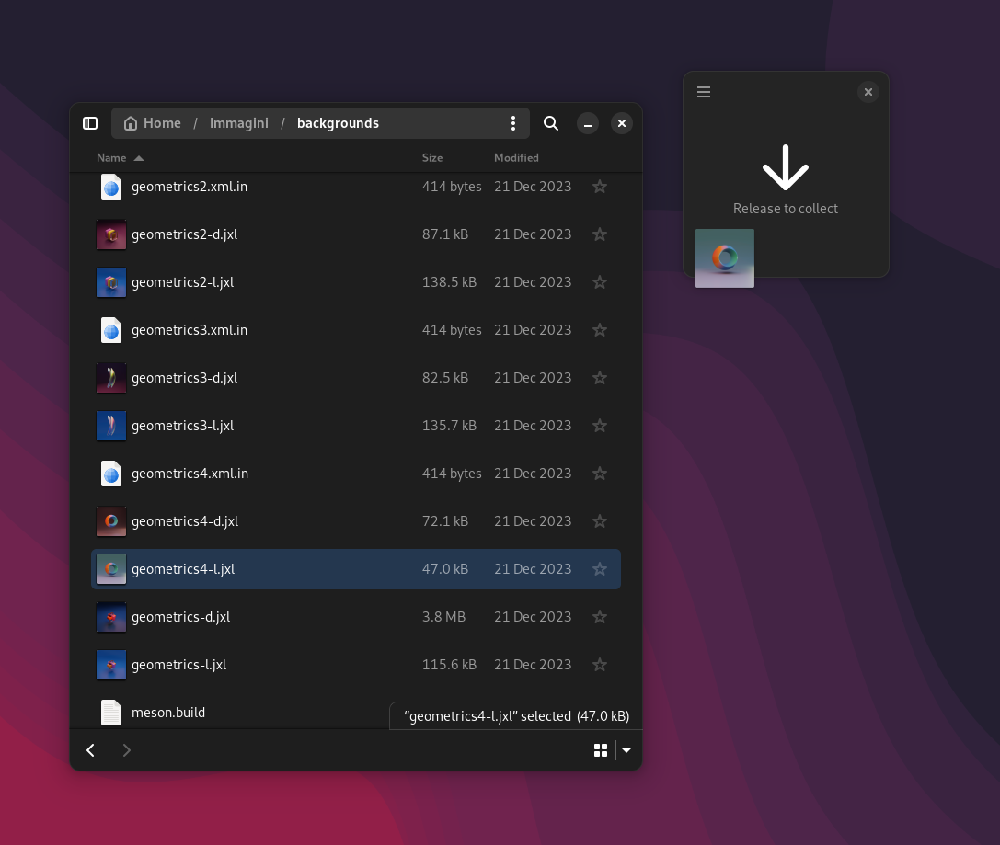

# Collector - Drag and Drop to the next level

<p align="center">

</p>

Drag multiple files and folders on to Collection window, drop them anywhere!

- Browse and preview all your dropped items
- Open multiple Collector windows with a shortcut and customize their color
- Easily drag images from web browser windows and download them automatically
- Drag directly from Google Images!
- Drop the content of your clipboard with `Ctrl + V`
- Optionally group your text drops into a single, ready-to-use CSV file
- Modern design built with LibAdawaita

## Get the app
<a href="https://flathub.org/it/apps/it.mijorus.collector" align="center">
  
</a>

## Build from source (without Flatpak)

`build.sh` configures, compiles, validates and installs the Meson project into a
user-writable prefix (default: `~/.local`). It checks for the required build
tools, GTK4/Libadwaita typelibs and Python dependencies, installing missing
Python packages into the user environment when needed.

```sh
./build.sh                          # install to ~/.local
./build.sh --smoke-test             # also launch the app briefly afterwards
PREFIX="$HOME/opt/collector" ./build.sh
./build.sh --help                   # all options
```

You need Meson, Ninja, the GTK4 and Libadwaita development packages (including
their GIR typelibs), PyGObject, gettext and pip. The script prints
distribution-specific installation hints if anything is missing.

## Get the GNOME extension

<a href="https://extensions.gnome.org/extension/6685/collector-complementary-extension/" align="center">
  
</a>


___



